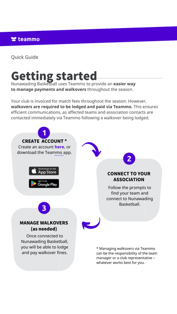
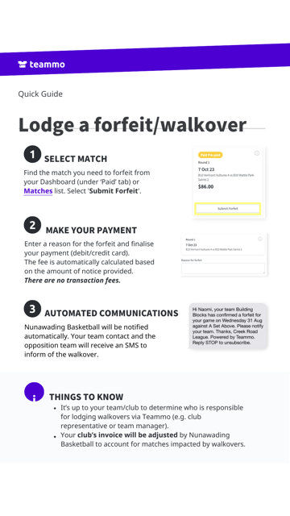

## Team sheet fees

From Winter 2024, the Club collects player contributions for team sheet fees when each player registers. Team sheet fees are paid by the Club directly to the Association.

Team Managers do not need to collect normal season team sheet fees from families or pay those fees each week.

## Teammo account

Team Managers still need to create a Teammo account and connect to their team each season. Teammo is used to receive walkover notifications and to lodge walkovers or forfeits if a team cannot play.

Because the Club has prepaid normal team sheet fees, the Teammo process may be slightly different from older instructions. Follow the current Association and Teammo prompts carefully.

Log in through [Teammo](https://app.teammo.com.au/login) to connect to your team or lodge a walkover/forfeit.

  
  

## Walkovers

A walkover occurs when a team does not have the minimum four players required to start a game and cannot play.

If your team lodges a walkover:

- The game is recorded as a loss for your team.
- The opposition is awarded the win and ladder points.
- The team is charged a $150 penalty fee by the Association.
- The walkover is submitted through Teammo. Teammo describes this as submitting a forfeit.

To avoid a walkover, contact your Age Group Coordinator as early as possible so they can help source eligible fill-in players. Fill-in players can be used to bring your team up to six players.

## Forfeits

A forfeit may occur when a team does not have the minimum four eligible players required to start a game, uses players who are not eligible for that grade, and is allowed to play the game without receiving ladder points.

This can avoid the walkover fee, but the team will not receive the game points even if it wins.

## Fill-in players

Fill-in players can help avoid walkovers, but they must be eligible. Check the fill-in player guidance and speak to your Age Group Coordinator before using a fill-in player.

Never allow a player to play under another player's name.

## Policy

For the full policy, refer to the [Walkover and Forfeit Policy](/uploads/kangas-walkover-forgeit-policy.pdf)
